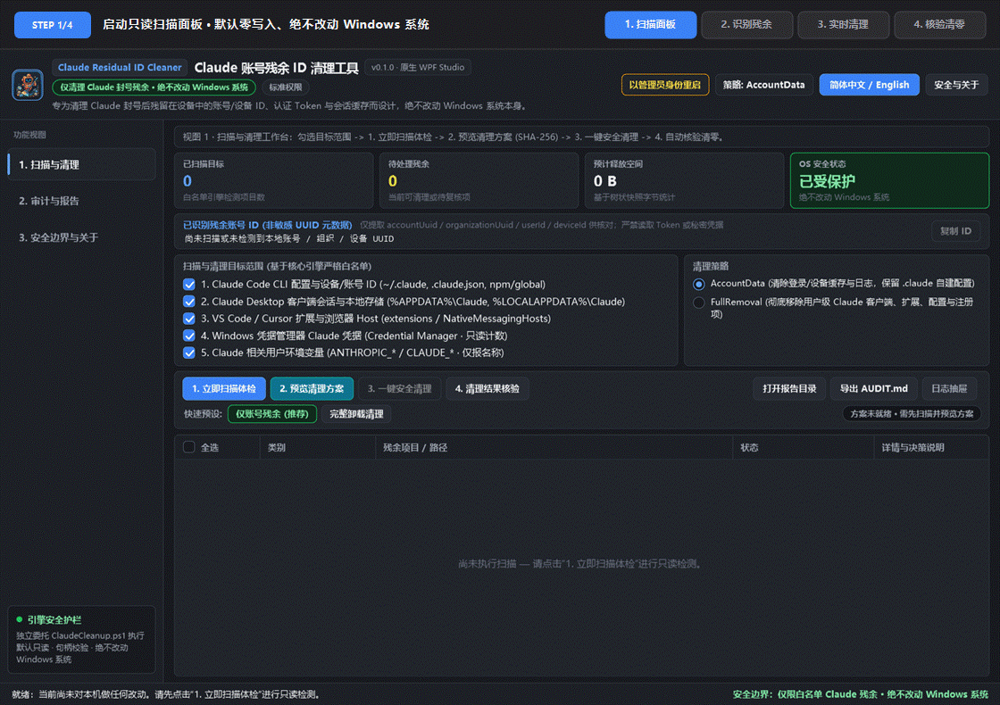
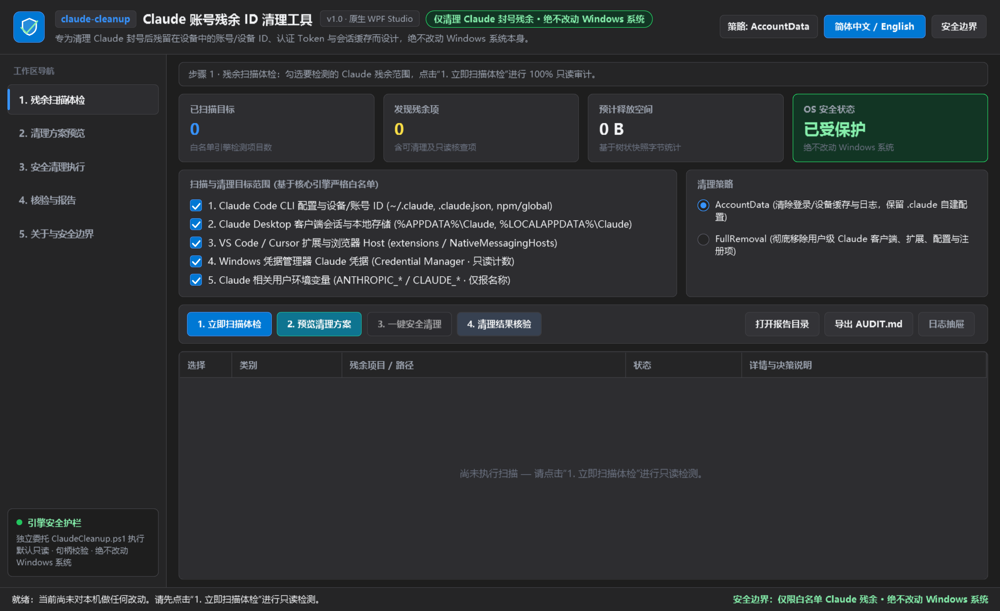
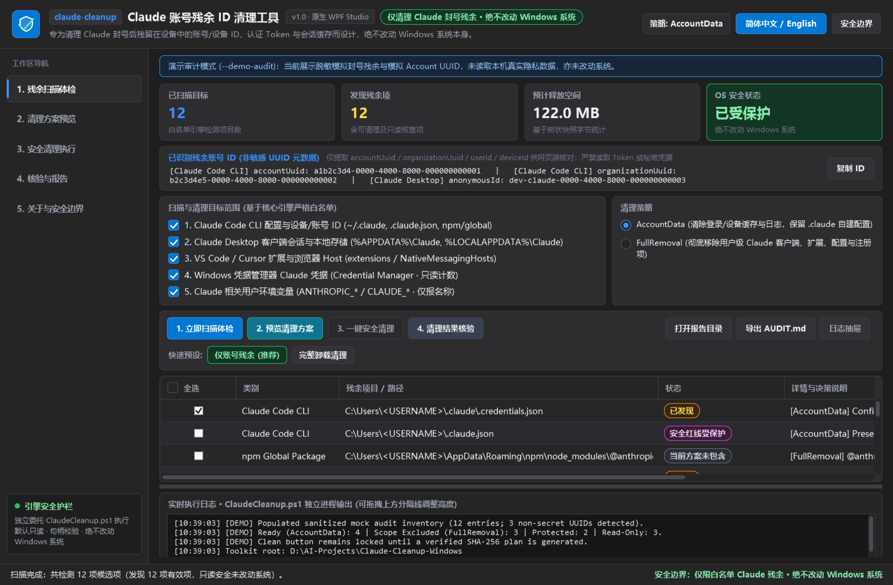
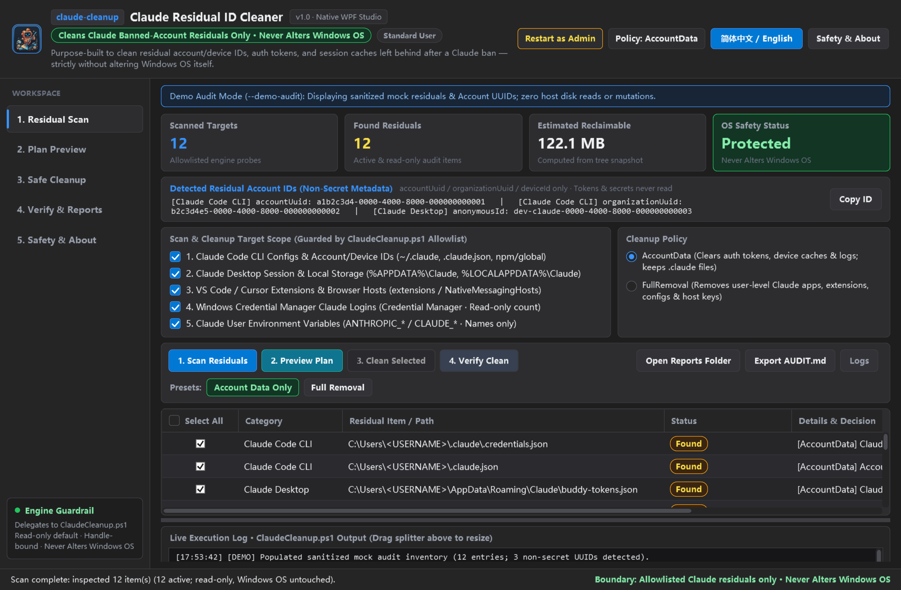

[简体中文](README.md) | English | [Cross-Agent Skill Guide](docs/Skills-Usage-Guide.en.md) | [CLI Reference](docs/CLI-Reference.md)

<div align="center">
  
  <h1>Claude Residual ID Cleaner</h1>
  <p><strong>Windows Post-Ban Claude Account Residual ID &amp; Cache Cleaner</strong></p>
  <p>Standalone Windows Desktop App + AI-Callable Agent Skill — 100% read-only by default, strictly never alters Windows OS itself</p>
  <p>
    <a href="https://github.com/YUCZ-43/Claude-Residual-ID-Cleaner/releases/latest"></a>
    
    <a href="LICENSE"></a>
    <a href="README.md"></a>
  </p>
</div>

<p align="center">
   Detect Residuals & UUIDs -> Real-Time Cleaning Progress -> Verify Zero Leftovers)" />
</p>

---

## Why Standard Uninstallation Leaves Banned-Account Residuals Behind

After a Claude Code CLI or Claude Desktop account ban, normal uninstallation or deleting the main executable still leaves persistent identity and session traces under your Windows user profile:

- **Account & Device Metadata**: `accountUuid`, `organizationUuid`, `userId`, and `deviceId` stored in `%USERPROFILE%\.claude.json` and Desktop preferences.
- **Auth & Extension Caches**: `.credentials.json`, `buddy-tokens.json`, `mcp-needs-auth-cache.json`, `stats-cache.json`, plus Electron `Cache`, `Network`, `Local Storage`, `IndexedDB`, `Session Storage`, and logs.
- **Background Locks & Browser Host Keys**: File locks held by `claude.exe`, `Claude.exe`, or `chrome-native-host.exe`, alongside HKCU Chrome/Edge Native Messaging host keys.

**Claude Residual ID Cleaner** scopes cleanup to a strict allowlist with a **Read-Only Audit -> Real-Time Streaming Clean -> Independent Zero-Leftover Verify** workflow while **never touching Windows OS files, system `MachineGuid`, WSL distros, or unrelated software**.

---

## Core Features & Safety Matrix

| Pillar | Implementation | Safety Guarantee |
| :--- | :--- | :--- |
| **3-View Modern Dark Studio UI** | Streamlined `ModernDarkStudio` 3-view workspace (`1. Scan & Clean`, `2. Reports & Export`, `3. Safety & About`), launching in `zh-CN` by default with instant live `en-US` toggle | The Clean button starts disabled until read-only scan, deterministic plan preview, and explicit confirmation complete |
| **Real-Time Cleaning Progress & 0-Remaining Banner** | Streams `@@PROGRESS@@` updates during cleanup to animate the progress bar and row badges (`Cleaning...` -> `Cleared`), then runs `-Verify` automatically and displays a 0-remaining completion summary banner | All discovery, Win32 handle-bound deletion (`SetFileInformationByHandle` / `NtDeleteKey`), and atomic replay-prevention ledger live solely in [ClaudeCleanup.ps1](ClaudeCleanup.ps1) with zero `Remove-Item` fallback |
| **Residual Account UUID Extraction** | Parses only non-secret `accountUuid`, `organizationUuid`, `userId`, and `deviceId` metadata from local configs with one-click copy | **Never reads** OAuth tokens, refresh tokens, session keys, API keys, or Windows Credential Manager secrets |
| **Self-Process Exclusion & Safe Close Prompt** | Excludes current/parent/grandparent PIDs and cleaner executables so it never flags itself; detects real Claude locks including `chrome-native-host.exe` | Never kills processes silently; only closes running Claude processes after explicit user confirmation (`-CloseRunningProcesses`) |
| **On-Demand Admin Elevation (Zero Startup UAC)** | Both desktop app and setup wizard embed standard `asInvoker` manifests; routine user-profile cleanup needs no admin rights | Zero forced UAC prompts at launch; users explicitly click **"Restart as Admin"** only when `BUILTIN\Administrators`-owned items require it |

---

## Step-by-Step Desktop Usage

1. **1. Scan Residuals**: Open `Claude-Residual-ID-Cleaner.exe` and click **"1. Scan Residuals"** (100% read-only) to inspect discovered UUIDs, running processes, and candidate items.
2. **2. Choose Policy & Preview Plan**: Default **`AccountData`** clears banned-account residuals, auth tokens, and Desktop caches while preserving your custom `.claude` skills/commands and `claude_desktop_config.json`; switch to **`FullRemoval`** to also uninstall Claude binaries, IDE extensions, and HKCU browser host keys. Click **"2. Preview Plan"** to generate `CLEANUP-PLAN.md` with a unique 64-hex SHA-256 digest.
3. **3. Confirm & Stream Cleanup**: Click **"3. Clean Selected"** to run a mandatory `-WhatIf` preview listing every `Ready` target; once confirmed, watch real-time per-item status badges update live.
4. **4. Auto-Verify Zero Remaining**: Independent `-Verify` runs automatically afterward (`Present` / `Absent` / `Unknown`) and renders the **0 remaining residuals** completion banner.

> Local cleanup affects only files and user-scoped registry keys on the local Windows machine and never alters remote Anthropic server-side account records.

---

## Quick Download & Verification (GitHub Releases)

Download standardized `v0.1.0` Windows (**x64** & **ARM64**) release artifacts directly from [GitHub Releases Latest](https://github.com/YUCZ-43/Claude-Residual-ID-Cleaner/releases/latest). **Both `portable.exe` and `setup.exe` embed the full [ClaudeCleanup.ps1](ClaudeCleanup.ps1) backend engine directly inside the assembly**: even when copied into a completely empty folder, the app verifies SHA-256 and extracts the core engine to `%LOCALAPPDATA%\Claude-Residual-ID-Cleaner\engine\<sha256-16>\` automatically.

| Release Artifact | Arch | Best For | Footprint & Privileges | Download |
| :--- | :--- | :--- | :--- | :--- |
| **`Claude-Residual-ID-Cleaner-0.1.0-x64-setup.exe`** | Windows x64 | **Setup Wizard (Recommended)**: Creates Desktop & Start Menu shortcuts and registers clean Add/Remove uninstall | Installs to `%LOCALAPPDATA%\Programs\Claude-Residual-ID-Cleaner` (**no UAC required**) | [Download x64 Setup](https://github.com/YUCZ-43/Claude-Residual-ID-Cleaner/releases/latest) |
| **`Claude-Residual-ID-Cleaner-0.1.0-x64-portable.exe`** | Windows x64 | **100% Self-Contained Portable `.exe`**: Embedded backend engine, zero installation, runs from any empty folder | Extracts & verifies embedded engine under `%LOCALAPPDATA%\Claude-Residual-ID-Cleaner\engine\` | [Download x64 Portable](https://github.com/YUCZ-43/Claude-Residual-ID-Cleaner/releases/latest) |
| **`Claude-Residual-ID-Cleaner-0.1.0-arm64-setup.exe`** | Windows ARM64 | **ARM64 Native Setup Wizard**: For Windows on ARM64 / Snapdragon devices (native PE `0xAA64`) | Installs to `%LOCALAPPDATA%\Programs\Claude-Residual-ID-Cleaner` (**no UAC required**) | [Download ARM64 Setup](https://github.com/YUCZ-43/Claude-Residual-ID-Cleaner/releases/latest) |
| **`Claude-Residual-ID-Cleaner-0.1.0-arm64-portable.exe`** | Windows ARM64 | **ARM64 Native Portable `.exe`**: Self-contained native `0xAA64` executable with embedded backend | Extracts & verifies embedded engine under `%LOCALAPPDATA%\Claude-Residual-ID-Cleaner\engine\` | [Download ARM64 Portable](https://github.com/YUCZ-43/Claude-Residual-ID-Cleaner/releases/latest) |
| **`Claude-Residual-ID-Cleaner-0.1.0-x64-bundle.zip`** | Windows x64 | **Full x64 Portable Bundle**: Contains `Claude-Residual-ID-Cleaner.exe`, PowerShell scripts, `skills/`, and docs | Extract anywhere for full desktop, CLI, and cross-agent Skill usage | [Download x64 Bundle](https://github.com/YUCZ-43/Claude-Residual-ID-Cleaner/releases/latest) |
| **`Claude-Residual-ID-Cleaner-0.1.0-arm64-bundle.zip`** | Windows ARM64 | **Full ARM64 Portable Bundle**: Contains native ARM64 `.exe`, PowerShell scripts, `skills/`, and docs | Extract anywhere for full ARM64 desktop, CLI, and cross-agent Skill usage | [Download ARM64 Bundle](https://github.com/YUCZ-43/Claude-Residual-ID-Cleaner/releases/latest) |
| **`SHA256SUMS.txt`** | All | **Integrity Checksums**: Provides 64-hex SHA-256 hashes for all 6 `x64` & `arm64` artifacts | Verify locally with PowerShell `Get-FileHash -Algorithm SHA256` | [View Checksums](https://github.com/YUCZ-43/Claude-Residual-ID-Cleaner/releases/latest) |

---

## AI-Callable Agent Skill

The repository ships a canonical cross-agent skill package at [skills/claude-cleanup/](skills/claude-cleanup/), exposing `claude-cleanup` as an **AI-invocable cleanup capability** (zero duplicated deletion logic; delegates strictly to [ClaudeCleanup.ps1](ClaudeCleanup.ps1) with a 100% read-only default and mandatory SHA-256 confirmation gate).

**One-command installation for Claude Code, Codex CLI, Antigravity, and Gemini CLI:**

```powershell
powershell.exe -NoProfile -File .\scripts\Install-ClaudeCleanup.ps1 -InstallSkill -SkillTarget All
```

**Copy-paste natural-language prompt:**

```text
Use the claude-cleanup skill to run a read-only audit (-Audit) on this machine, summarize any detected Claude account UUIDs, running processes, and cleanup candidates, and do not delete anything until I explicitly approve the SHA-256 manifest hash.
```

For per-agent paths and workflow examples across Antigravity, Codex CLI, Claude Code, and Gemini CLI, see [Cross-Agent Skill Usage Guide](docs/Skills-Usage-Guide.en.md) ([简体中文实战指南](docs/Skills-Usage-Guide.md)), [SKILL.md](skills/claude-cleanup/SKILL.md), and [Permissions & Risks](skills/claude-cleanup/references/permissions-and-risks.md).

---

## Desktop Studio Gallery

<table>
  <tr>
    <td align="center" width="33%">
      
      <br /><sub><b>Read-Only Studio Dashboard (zh-CN)</b></sub>
    </td>
    <td align="center" width="33%">
      
      <br /><sub><b>Live Scan &amp; Non-Secret UUID View</b></sub>
    </td>
    <td align="center" width="33%">
      
      <br /><sub><b>Instant Live Language Toggle (en-US)</b></sub>
    </td>
  </tr>
</table>

---

## CLI Reference, Offline Build & Automated Tests

<details>
<summary><b>Expand: PowerShell CLI commands, offline compilation, and isolated sandbox tests</b></summary>

### 1. Native PowerShell CLI Commands ([Full CLI Reference](docs/CLI-Reference.md))

| Command | Purpose | Disk Write Behavior |
| :--- | :--- | :--- |
| `.\ClaudeCleanup.ps1 -Audit [-SaveAuditReport] [-OutputFormat Json]` | Read-only scan of leftovers, non-secret UUIDs, ACL ownership, shortcuts, and env var names | None (writes `AUDIT.md` only with `-SaveAuditReport`) |
| `.\ClaudeCleanup.ps1 -Plan [-Language zh-CN\|en-US]` | Generate deterministic `CLEANUP-PLAN.md` (`SchemaVersion = 3`) with GUID `PlanId` and SHA-256 | Writes `CLEANUP-PLAN.md` only |
| `.\ClaudeCleanup.ps1 -Apply -Policy <AccountData\|FullRemoval> -ApprovedManifestSha256 <64-hex> -WhatIf` | Dry-run preview of approved targets without consuming the manifest hash | None |
| `.\ClaudeCleanup.ps1 -Apply -Policy <Policy> -ApprovedManifestSha256 <64-hex> [-CloseRunningProcesses] [-EmitProgress]` | Execute Win32 handle-bound deletion after `ConfirmImpact = 'High'` confirmation | Deletes approved targets; atomically updates `VERIFICATION.md` |
| `.\ClaudeCleanup.ps1 -Verify [-OutputFormat Json]` | Independent read-only verification (`Present` / `Absent` / `Unknown`) and replay ledger check | None |

You can also launch the interactive console menu ([ClaudeCleanupLauncher.cmd](ClaudeCleanupLauncher.cmd)) or zero-compile WinForms wrapper ([ClaudeCleanupGUI.cmd](ClaudeCleanupGUI.cmd)).

### 2. Build & Package Offline From Source

```powershell
.\scripts\New-AppIcon.ps1                 # Generate mascot logo & multi-size app.ico
.\scripts\Build-DesktopApp.ps1            # Compile dist\Claude-Residual-ID-Cleaner-0.1.0-x64-portable.exe
.\scripts\Build-Installer.ps1             # Compile dist\Claude-Residual-ID-Cleaner-0.1.0-x64-setup.exe
.\scripts\New-ReleasePackage.ps1 -BuildSetupExe  # Build bundle.zip, setup.exe, portable.exe & SHA256SUMS.txt
```

### 3. Isolated Sandbox Test Suites (Windows PowerShell 5.1 & PowerShell 7+)

All tests create temporary fixtures strictly inside `tests/sandbox/` and clean up in `finally` blocks without touching live Claude data or HKCU keys (CI workflow: [.github/workflows/ci.yml](.github/workflows/ci.yml)):

```powershell
powershell.exe -NoProfile -File .\tests\ClaudeCleanup.Tests.ps1
powershell.exe -NoProfile -File .\tests\SkillPackage.Tests.ps1
powershell.exe -NoProfile -File .\tests\ToolkitInstall.Tests.ps1
powershell.exe -NoProfile -File .\tests\ToolkitCiChecks.Tests.ps1
powershell.exe -NoProfile -File .\tests\BilingualAndGui.Tests.ps1
powershell.exe -NoProfile -File .\tests\DesktopApp.Tests.ps1
```

</details>

---

## Documentation & License

- **Guides & Governance**: [Launcher & Install Guide](docs/Launcher-and-Install.md) · [Uninstallation Guide](docs/Uninstallation-Guide.md) · [Troubleshooting & Compatibility](docs/Troubleshooting-and-Compatibility.md) · [Security Policy (SECURITY.md)](SECURITY.md) · [Changelog (CHANGELOG.md)](CHANGELOG.md) · [Contributing (CONTRIBUTING.md)](CONTRIBUTING.md)
- **License & Independence Notice**: Released under the [MIT License](LICENSE); see [NOTICE](NOTICE) for clean-room implementation and trademark details. Built independently for Windows and not affiliated with Anthropic PBC.

## Star History

[](https://www.star-history.com/#YUCZ-43/Claude-Residual-ID-Cleaner&Date)
