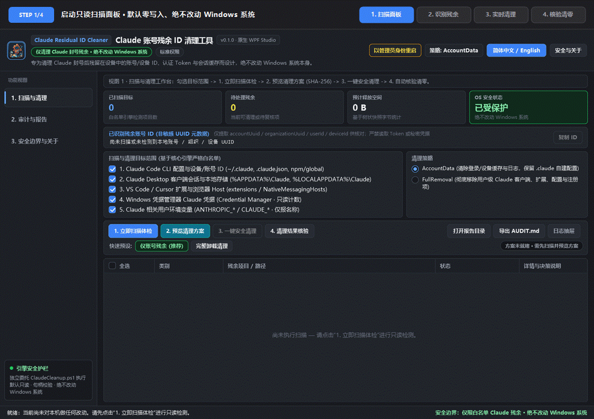
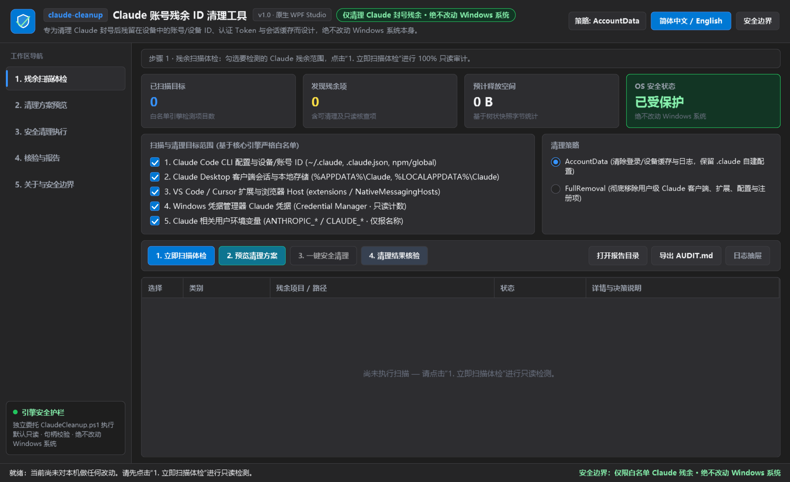
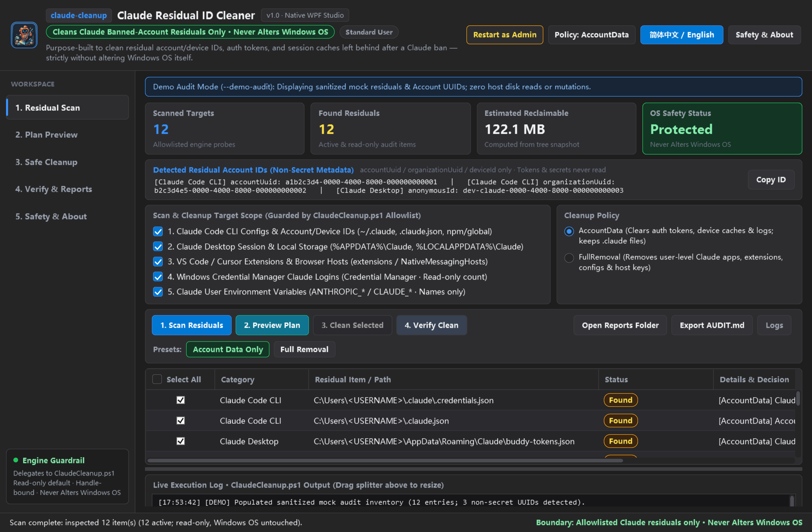

简体中文 | [English](README.en.md) | [跨代理 Skill 实战指南](docs/Skills-Usage-Guide.md) | [CLI 命令参考](docs/CLI-Reference.md)

<div align="center">
  
  <h1>claude-cleanup</h1>
  <p><strong>Claude 账号残余 ID 清理工具 / Claude Residual ID Cleaner</strong></p>
  <p>专为 Windows 用户设计的 Claude 封号残余账号 ID 与缓存清理工具 — 独立桌面软件 + AI 技能双驱动，默认只读体检，绝不改动 Windows 系统本身</p>
  <p>
    <a href="https://github.com/YUCZ-43/claude-cleanup/releases/latest"></a>
    
    <a href="LICENSE"></a>
    <a href="README.en.md"></a>
  </p>
</div>

<p align="center">
   识别残留 -> 核验清零）" />
</p>

---

## 核心特性与安全矩阵

| 核心能力 | 实现机制 | 安全边界保障 |
| :--- | :--- | :--- |
| **残余账号 UUID 精准识别** | 仅解析本地配置文件中的非敏感 `accountUuid`、`organizationUuid`、`userId` 与 `deviceId`，支持界面一键复制核对 | **严禁读取** OAuth Token、Refresh Token、Session Key、API Key 或 Windows 凭据秘密值 |
| **进程自检防误判与一键关闭** | 通过当前/父/祖父 PID 链路、自身可执行文件名及工作区路径严格排除本清理器自身，仅精准匹配真实 Claude 进程 | 默认不强制杀进程；仅在检测到占用并由用户**明确弹窗确认**后，传递 `-CloseRunningProcesses` 安全关闭 |
| **按需管理员提权（零启动 UAC）** | 桌面端与安装向导均嵌入标准 `asInvoker` 清单，绝大多数用户目录清理无需管理员权限即可完成 | 启动绝不强制弹出 UAC；仅在需要处理 ACL 受限项时由用户主动点击右上角 **“以管理员身份重启”** |
| **绝不改动 Windows 系统红线** | 全部发现、校对、Win32 句柄绑定删除与台账逻辑集中于单引擎 [ClaudeCleanup.ps1](ClaudeCleanup.ps1)，无 `Remove-Item` 回退 | 严禁触碰 `C:\Windows`、`Program Files`、系统硬件 `MachineGuid`、WSL 发行版或 Edge/Chrome 个人配置文件 |

---

## 快速下载与运行（GitHub Releases）

前往 [GitHub Releases 最新版本](https://github.com/YUCZ-43/claude-cleanup/releases/latest) 直接获取已签名校验的 Windows 可执行文件：

| 安装包 / 产物 | 适用场景 | 安装位置与权限 | 下载与校验 |
| :--- | :--- | :--- | :--- |
| **`Claude-Residual-ID-Cleaner-Setup.exe`** | **标准安装向导版（推荐普通用户）**：自动创建桌面与开始菜单快捷方式，支持 Windows“应用和功能”一键卸载 | 默认安装至 `%LOCALAPPDATA%\Programs\claude-cleanup`（**标准用户免 UAC**） | [下载 Setup 安装包](https://github.com/YUCZ-43/claude-cleanup/releases/latest) |
| **`Claude-Residual-ID-Cleaner.exe`** | **绿色单文件版（推荐便携运行）**：免安装、零注册表写入，双击即用 | 任意本地目录（需同目录或上级目录含核心脚本，或直接使用发布压缩包） | [下载绿色单文件版](https://github.com/YUCZ-43/claude-cleanup/releases/latest) |
| **`claude-cleanup-0.1.0.zip`** | **完整便携源码包 + 校验清单**：含绿色 `.exe`、全部 PowerShell 脚本、`skills/` 及 `SHA256SUMS.txt` | 解压即用；可用 `Get-FileHash` 对照 `SHA256SUMS.txt` 校验完整性 | [下载完整压缩包](https://github.com/YUCZ-43/claude-cleanup/releases/latest) |

> **双策略防误删设计**：默认 **`AccountData`** 一键清除全部 Claude 封号残余（含 `.credentials.json`、`.claude.json` 账号元数据、`buddy-tokens.json`、`mcp-needs-auth-cache.json`、`stats-cache.json` 及桌面端 `Cache`/`Network`/`Local Storage`/`IndexedDB`/日志），仅保留您自建的 `.claude` 技能/命令与 `claude_desktop_config.json`；仅当您主动切换至 **`FullRemoval`** 并确认 64 位 SHA-256 清单哈希后，才进一步卸载 Claude 客户端/CLI 程序本体、IDE 扩展与 HKCU 浏览器宿主键。本地清理不会改变远端服务器侧账号状态。

---

## AI 助手可调用技能（Agent Skill）

本仓库内置标准跨代理技能包 [skills/claude-cleanup/](skills/claude-cleanup/)，将 `claude-cleanup` 封装为 **AI 可直接调用的安全清理能力**（零复制删除逻辑，底层严格委托 [ClaudeCleanup.ps1](ClaudeCleanup.ps1) 执行；默认 100% 只读体检，真实清理前必须由您确认 SHA-256 方案哈希）。

**一步部署到 Claude Code / Codex CLI / Antigravity / Gemini CLI：**

```powershell
powershell.exe -NoProfile -File .\scripts\Install-ClaudeCleanup.ps1 -InstallSkill -SkillTarget All
```

**复制即用的自然语言唤醒词示例：**

```text
请使用 claude-cleanup 技能对本机执行一次只读残余体检（-Audit），列出识别到的 Claude 账号 UUID、占用进程与建议清理项；在得到我明确确认 SHA-256 哈希前，不要执行任何删除操作。
```

更多关于 Antigravity、Codex CLI、Claude Code 与 Gemini CLI 的安装目录与实战模板，请查阅 [跨代理 Skill 实战使用指南](docs/Skills-Usage-Guide.md)（[English Guide](docs/Skills-Usage-Guide.en.md)）、[技能规范 (SKILL.md)](skills/claude-cleanup/SKILL.md) 与 [权限边界说明](skills/claude-cleanup/references/permissions-and-risks.md)。

---

## 桌面端实机界面一览

<table>
  <tr>
    <td align="center" width="33%">
      
      <br /><sub><b>只读体检主工作台（简体中文）</b></sub>
    </td>
    <td align="center" width="33%">
      
      <br /><sub><b>扫描结果与非敏感 UUID 识别</b></sub>
    </td>
    <td align="center" width="33%">
      
      <br /><sub><b>一键实时切换英文界面（en-US）</b></sub>
    </td>
  </tr>
</table>

---

## 命令行（CLI）、离线构建与自动化测试

<details>
<summary><b>展开查看：PowerShell CLI 常用命令、从源码编译与双版本测试命令</b></summary>

### 1. 原生 PowerShell CLI 核心命令（[完整 CLI 参考](docs/CLI-Reference.md)）

| 命令 | 作用 | 磁盘写入 |
| :--- | :--- | :--- |
| `.\ClaudeCleanup.ps1 -Audit [-SaveAuditReport] [-OutputFormat Json]` | 只读扫描残余文件、非敏感 UUID、ACL 所有权、快捷方式与环境变量名 | 默认无写入（加 `-SaveAuditReport` 写入 `AUDIT.md`） |
| `.\ClaudeCleanup.ps1 -Plan [-Language zh-CN\|en-US]` | 生成含唯一 `PlanId` 与 SHA-256 哈希的 `CLEANUP-PLAN.md`（`SchemaVersion = 3`） | 仅写入 `CLEANUP-PLAN.md` |
| `.\ClaudeCleanup.ps1 -Apply -Policy <AccountData\|FullRemoval> -ApprovedManifestSha256 <64位哈希> -WhatIf` | 干跑校验清单并预览待删目标，不消耗授权哈希 | 无写入 |
| `.\ClaudeCleanup.ps1 -Apply -Policy <Policy> -ApprovedManifestSha256 <64位哈希> [-CloseRunningProcesses]` | 经 `ConfirmImpact = 'High'` 二次确认后执行 Win32 句柄绑定删除 | 删除获批目标并原子更新 `VERIFICATION.md` |
| `.\ClaudeCleanup.ps1 -Verify [-OutputFormat Json]` | 独立核验三态（`Present` / `Absent` / `Unknown`）及防重放台账 | 无写入 |

也可以直接运行交互式控制台启动器 [ClaudeCleanupLauncher.cmd](ClaudeCleanupLauncher.cmd) 或免编译脚本版界面 [ClaudeCleanupGUI.cmd](ClaudeCleanupGUI.cmd)。

### 2. 从源码离线编译与打包

```powershell
.\scripts\New-AppIcon.ps1                 # 生成吉祥物 logo 与多分辨率 app.ico
.\scripts\Build-DesktopApp.ps1            # 编译绿色版 dist\Claude-Residual-ID-Cleaner.exe
.\scripts\Build-Installer.ps1             # 编译安装向导 dist\Claude-Residual-ID-Cleaner-Setup.exe
.\scripts\New-ReleasePackage.ps1          # 生成发布压缩包与 SHA256SUMS.txt
```

### 3. 隔离沙箱自动化测试（Windows PowerShell 5.1 与 PowerShell 7+）

所有测试仅在临时目录 `tests/sandbox/` 内构造夹具并自动清理，绝不改动真实系统与 Claude 数据（CI 配置见 [.github/workflows/ci.yml](.github/workflows/ci.yml)）：

```powershell
powershell.exe -NoProfile -File .\tests\ClaudeCleanup.Tests.ps1
powershell.exe -NoProfile -File .\tests\SkillPackage.Tests.ps1
powershell.exe -NoProfile -File .\tests\ToolkitInstall.Tests.ps1
powershell.exe -NoProfile -File .\tests\ToolkitCiChecks.Tests.ps1
powershell.exe -NoProfile -File .\tests\BilingualAndGui.Tests.ps1
powershell.exe -NoProfile -File .\tests\DesktopApp.Tests.ps1
```

</details>

---

## 相关文档与开源许可

- **使用与治理文档**：[启动器与生命周期指南](docs/Launcher-and-Install.md) · [卸载指南](docs/Uninstallation-Guide.md) · [故障排查与兼容性](docs/Troubleshooting-and-Compatibility.md) · [安全模型 (SECURITY.md)](SECURITY.md) · [更新日志 (CHANGELOG.md)](CHANGELOG.md) · [贡献指南 (CONTRIBUTING.md)](CONTRIBUTING.md)
- **开源许可与致谢**：基于 [MIT License](LICENSE) 开源，版权及洁净室实现说明见 [NOTICE](NOTICE)。概念启发自 macOS 脚本项目 [suyuan2022/claude-cleanup](https://github.com/suyuan2022/suyuan-skill/tree/main/claude-cleanup)；本项目为 Windows 原生独立洁净室实现，与 Anthropic PBC 无隶属或授权关系。

## Star History

[](https://www.star-history.com/#YUCZ-43/claude-cleanup&Date)
