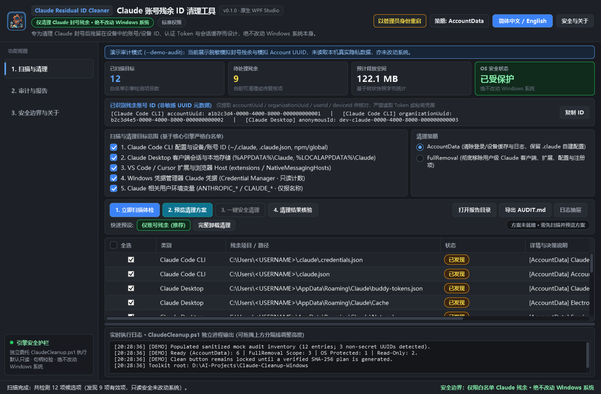

简体中文 | [English](README.en.md) | [跨代理 Skill 实战指南](docs/Skills-Usage-Guide.md) | [CLI 命令参考](docs/CLI-Reference.md)

<div align="center">
  
  <h1>Claude Residual ID Cleaner</h1>
  <p><strong>Claude 账号残余 ID 清理工具</strong></p>
  <p>专为 Windows 用户打造的 Claude 封号残余账号 ID、认证凭据与会话缓存清理工具 — 独立桌面软件 + AI 技能双驱动，默认只读体检，绝不改动 Windows 系统本身</p>
  <p>
    <a href="https://github.com/YUCZ-43/Claude-Residual-ID-Cleaner/releases/latest"></a>
    
    <a href="LICENSE"></a>
    <a href="README.en.md"></a>
  </p>
</div>

<p align="center">
   识别残余与 UUID -> 实时清理进度 -> 核验清零）" />
</p>

---

## 为什么常规卸载清不干净 Claude 封号残余？

当 Claude Code CLI 或 Claude Desktop 账号遭遇封禁后，常规卸载或直接删除主程序仍会在用户目录下遗留大量关联身份与状态数据：

- **身份与元数据残留**：`%USERPROFILE%\.claude.json` 与桌面端配置中保留的 `accountUuid`、`organizationUuid`、`userId`、`deviceId`。
- **认证与扩展缓存残留**：`.credentials.json`、`buddy-tokens.json`、`mcp-needs-auth-cache.json`、`stats-cache.json`，以及桌面端 `Cache`、`Network`、`Local Storage`、`IndexedDB`、`Session Storage` 与日志。
- **后台进程与宿主键占用**：残留在后台的 `claude.exe`、`Claude.exe`、`chrome-native-host.exe` 文件锁，以及 Chrome / Edge 的 HKCU Native Messaging 宿主键。

**Claude Residual ID Cleaner** 将所有封号残余定位为精准白名单，提供**只读预览 -> 实时流式清理 -> 独立后验清零**的闭环，同时**严守绝不改动 Windows 系统文件、系统 `MachineGuid`、WSL 或无关软件**的安全红线。

---

## 核心特性与安全矩阵

| 核心能力 | 实现机制 | 安全边界保障 |
| :--- | :--- | :--- |
| **三视图现代深色工作台** | 桌面端采用 `ModernDarkStudio` 三视图精简布局（`1. 扫描与清理`、`2. 审计与报告`、`3. 安全边界与关于`），启动默认简体中文并支持一键切换英文 | 初始禁用“安全清理”按钮；必须完成扫描、方案预览并二次确认后方可解锁执行 |
| **实时清理进度与清零核验** | 执行清理时通过后台 `@@PROGRESS@@` 实时流式回传逐项状态，界面即时更新进度条与行徽章（`清理中...` -> `已彻底清除`），结束后自动执行 `-Verify` 并展示“0 项剩余”核验横幅 | 全部发现、Win32 句柄绑定删除（`SetFileInformationByHandle` / `NtDeleteKey`）与原子防重放台账均集中于 [ClaudeCleanup.ps1](ClaudeCleanup.ps1)，无 `Remove-Item` 回退 |
| **残余账号 UUID 精准识别** | 仅解析本地配置中的非敏感 `accountUuid`、`organizationUuid`、`userId` 与 `deviceId`，支持桌面端一键复制核对 | **严禁读取** OAuth Token、Refresh Token、Session Key、API Key 或 Windows 凭据秘密值 |
| **进程自检防误判与关闭提示** | 通过当前/父/祖父 PID 链路与自身可执行文件名严格排除本清理器自身，精准识别包含 `chrome-native-host.exe` 在内的真实 Claude 进程占用 | 默认不强制结束进程；仅在检测到占用并由用户**明确弹窗确认**后，传递 `-CloseRunningProcesses` 安全关闭 |
| **按需管理员提权（零启动 UAC）** | 桌面端与安装向导均嵌入标准 `asInvoker` 清单，日常用户目录清理无需管理员权限即可完成 | 启动绝不强制弹出 UAC；仅在存在 `BUILTIN\Administrators` 属主条目时，由用户主动点击右上角 **“以管理员身份重启”** |

---

## 桌面端四步使用流程

1. **1. 扫描体检**：打开 `Claude-Residual-ID-Cleaner.exe`，点击 **“1. 立即扫描体检”**（100% 只读），即时查看本机识别到的账号 UUID、进程占用与候选清理项。
2. **2. 选择策略并预览方案**：默认采用 **`AccountData`**（清除全部封号残余、Token 与桌面缓存，同时保留您自建的 `.claude` 技能/命令与 `claude_desktop_config.json`）；如需连同程序本体、IDE 扩展与 HKCU 浏览器宿主键一并卸载，可切换至 **`FullRemoval`**。点击 **“2. 预览清理方案”** 生成带唯一 64 位 SHA-256 哈希的 `CLEANUP-PLAN.md`。
3. **3. 确认并实时清理**：点击 **“3. 一键安全清理”**，工具先自动运行 `-WhatIf` 干跑并列出全部 `Ready` 目标供最终确认；确认后即可实时观看每条记录的清理进度。
4. **4. 自动核验清零**：清理完成后自动执行 `-Verify` 独立三态复检（`Present` / `Absent` / `Unknown`），并在顶部展示 **已清理数量与剩余 0 项残留** 的核验横幅。

> 本地清理仅作用于当前 Windows 设备上的本地文件与用户级注册表项，不会更改远端 Anthropic 服务器侧账号状态。

---

## 快速下载与校验（GitHub Releases）

前往 [GitHub Releases 最新版本](https://github.com/YUCZ-43/Claude-Residual-ID-Cleaner/releases/latest) 获取标准 `v0.1.0` (`x64`) 发布产物：

| 发布产物文件名 | 适用场景 | 安装位置与权限 | 下载链接 |
| :--- | :--- | :--- | :--- |
| **`Claude-Residual-ID-Cleaner-0.1.0-x64-setup.exe`** | **标准安装向导版（推荐普通用户）**：自动创建桌面与开始菜单快捷方式，支持 Windows“应用和功能”干净卸载 | 默认安装至 `%LOCALAPPDATA%\Programs\Claude-Residual-ID-Cleaner`（**标准用户免 UAC**） | [下载 Setup 安装包](https://github.com/YUCZ-43/Claude-Residual-ID-Cleaner/releases/latest) |
| **`Claude-Residual-ID-Cleaner-0.1.0-x64-portable.exe`** | **绿色单文件版（推荐便携运行）**：免安装、零 Add/Remove 注册表写入，双击即用 | 任意本地目录（需同目录或上级目录含核心脚本，或配合完整压缩包使用） | [下载绿色单文件版](https://github.com/YUCZ-43/Claude-Residual-ID-Cleaner/releases/latest) |
| **`Claude-Residual-ID-Cleaner-0.1.0-x64-bundle.zip`** | **完整便携包**：内含 `Claude-Residual-ID-Cleaner.exe`、全部 PowerShell 后端脚本、`skills/` 及文档 | 解压即用，支持完整桌面端、CLI 与跨代理 Skill | [下载完整压缩包](https://github.com/YUCZ-43/Claude-Residual-ID-Cleaner/releases/latest) |
| **`SHA256SUMS.txt`** | **完整性校验清单**：包含上述所有 x64 发布产物的 64 位 SHA-256 哈希 | 下载后使用 PowerShell `Get-FileHash -Algorithm SHA256` 对照核验 | [查看校验文件](https://github.com/YUCZ-43/Claude-Residual-ID-Cleaner/releases/latest) |

---

## AI 助手可调用技能（Agent Skill）

本仓库内置标准跨代理技能包 [skills/claude-cleanup/](skills/claude-cleanup/)，将本工具封装为 **AI 可直接调用的安全清理能力**（零重复删除逻辑，严格委托 [ClaudeCleanup.ps1](ClaudeCleanup.ps1) 执行；默认 100% 只读体检，真实清理前必须由您确认 64 位 SHA-256 哈希）。

**一步部署到 Claude Code / Codex CLI / Antigravity / Gemini CLI：**

```powershell
powershell.exe -NoProfile -File .\scripts\Install-ClaudeCleanup.ps1 -InstallSkill -SkillTarget All
```

**复制即用的自然语言提示词：**

```text
请使用 claude-cleanup 技能对本机执行一次只读残余体检（-Audit），列出识别到的 Claude 账号 UUID、占用进程与建议清理项；在得到我明确确认 SHA-256 哈希前，不要执行任何删除操作。
```

完整安装路径与四端实战模板请查阅 [跨代理 Skill 实战指南](docs/Skills-Usage-Guide.md)（[English Guide](docs/Skills-Usage-Guide.en.md)）、[技能规范 (SKILL.md)](skills/claude-cleanup/SKILL.md) 与 [权限边界说明](skills/claude-cleanup/references/permissions-and-risks.md)。

---

## 桌面端界面一览

<table>
  <tr>
    <td align="center" width="33%">
      
      <br /><sub><b>只读扫描工作台（简体中文）</b></sub>
    </td>
    <td align="center" width="33%">
      
      <br /><sub><b>残余列表与非敏感 UUID 识别</b></sub>
    </td>
    <td align="center" width="33%">
      
      <br /><sub><b>一键实时切换英文界面（en-US）</b></sub>
    </td>
  </tr>
</table>

---

## 命令行（CLI）、离线编译与沙箱测试

<details>
<summary><b>展开查看：PowerShell CLI 核心命令、源码离线编译与隔离沙箱测试</b></summary>

### 1. 原生 PowerShell CLI 核心命令（[完整 CLI 参考](docs/CLI-Reference.md)）

| 命令 | 作用 | 磁盘写入 |
| :--- | :--- | :--- |
| `.\ClaudeCleanup.ps1 -Audit [-SaveAuditReport] [-OutputFormat Json]` | 只读扫描残余文件、非敏感 UUID、ACL 所有权、快捷方式与环境变量名 | 默认无写入（加 `-SaveAuditReport` 写入 `AUDIT.md`） |
| `.\ClaudeCleanup.ps1 -Plan [-Language zh-CN\|en-US]` | 生成含唯一 `PlanId` 与 SHA-256 哈希的 `CLEANUP-PLAN.md`（`SchemaVersion = 3`） | 仅写入 `CLEANUP-PLAN.md` |
| `.\ClaudeCleanup.ps1 -Apply -Policy <AccountData\|FullRemoval> -ApprovedManifestSha256 <64位哈希> -WhatIf` | 干跑校验清单并预览待删目标，不消耗授权哈希 | 无写入 |
| `.\ClaudeCleanup.ps1 -Apply -Policy <Policy> -ApprovedManifestSha256 <64位哈希> [-CloseRunningProcesses] [-EmitProgress]` | 经 `ConfirmImpact = 'High'` 确认后执行 Win32 句柄绑定删除（可选流式进度输出） | 删除获批目标并原子更新 `VERIFICATION.md` |
| `.\ClaudeCleanup.ps1 -Verify [-OutputFormat Json]` | 独立核验三态（`Present` / `Absent` / `Unknown`）及防重放台账 | 无写入 |

也可以直接运行交互式控制台启动器 [ClaudeCleanupLauncher.cmd](ClaudeCleanupLauncher.cmd) 或免编译脚本版界面 [ClaudeCleanupGUI.cmd](ClaudeCleanupGUI.cmd)。

### 2. 从源码离线编译与标准化打包

```powershell
.\scripts\New-AppIcon.ps1                 # 生成吉祥物 logo 与多分辨率 app.ico
.\scripts\Build-DesktopApp.ps1            # 编译 dist\Claude-Residual-ID-Cleaner-0.1.0-x64-portable.exe
.\scripts\Build-Installer.ps1             # 编译 dist\Claude-Residual-ID-Cleaner-0.1.0-x64-setup.exe
.\scripts\New-ReleasePackage.ps1 -BuildSetupExe  # 生成 bundle.zip、setup.exe、portable.exe 与 SHA256SUMS.txt
```

### 3. 隔离沙箱自动化测试（Windows PowerShell 5.1 与 PowerShell 7+）

所有测试仅在临时目录 `tests/sandbox/` 内构造夹具并自动清理，绝不改动真实系统与 Claude 数据（CI 配置见 [.github/workflows/ci.yml](.github/workflows/ci.yml)）：

```powershell
powershell.exe -NoProfile -File .\tests\ClaudeCleanup.Tests.ps1
powershell.exe -NoProfile -File .\tests\SkillPackage.Tests.ps1
powershell.exe -NoProfile -File .\tests\ToolkitInstall.Tests.ps1
powershell.exe -NoProfile -File .\tests\ToolkitCiChecks.Tests.ps1
powershell.exe -NoProfile -File .\tests\BilingualAndGui.Tests.ps1
powershell.exe -NoProfile -File .\tests\DesktopApp.Tests.ps1
```

</details>

---

## 相关文档与开源许可

- **使用与治理文档**：[启动器与生命周期指南](docs/Launcher-and-Install.md) · [卸载指南](docs/Uninstallation-Guide.md) · [故障排查与兼容性](docs/Troubleshooting-and-Compatibility.md) · [安全模型 (SECURITY.md)](SECURITY.md) · [更新日志 (CHANGELOG.md)](CHANGELOG.md) · [贡献指南 (CONTRIBUTING.md)](CONTRIBUTING.md)
- **开源许可与独立声明**：基于 [MIT License](LICENSE) 开源，独立洁净室实现与商标声明见 [NOTICE](NOTICE)。本项目为 Windows 原生独立开源工具，与 Anthropic PBC 无任何隶属或授权关系。

## Star History

[](https://www.star-history.com/#YUCZ-43/Claude-Residual-ID-Cleaner&Date)
