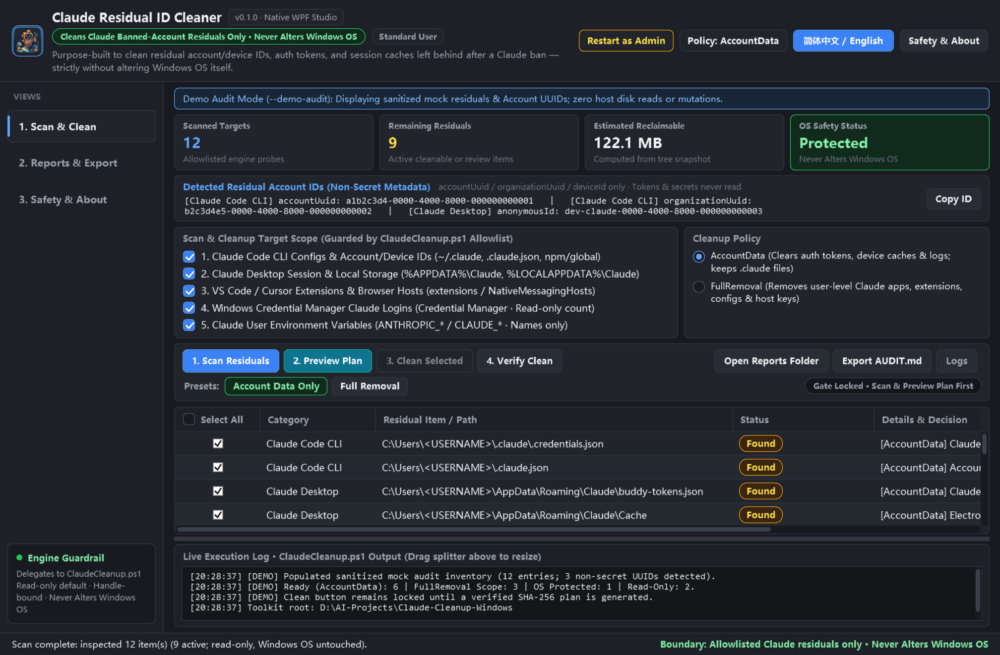

[简体中文](Skills-Usage-Guide.md) | English

# Claude Residual ID Cleaner — Cross-Agent Skill Usage Guide

**Project:** `YUCZ-43/Claude-Residual-ID-Cleaner` (`Claude Residual ID Cleaner`)  
**Canonical Skill Package:** [skills/claude-cleanup/SKILL.md](../skills/claude-cleanup/SKILL.md)  
**Related Docs:** [简体中文 README](../README.md) | [English README](../README.en.md) | [CLI Reference](./CLI-Reference.md) | [Agent Skill Security Spec](./Agent-Skill-Guide.md)

This guide shows how to install, activate, invoke, and maintain the `claude-cleanup` Agent Skill safely across **Antigravity (`agy` CLI & Desktop)**, **Codex CLI**, **Claude Code**, and **Gemini CLI** on Windows.

> Prefer an interactive window? Run the bundled `Claude-Residual-ID-Cleaner.exe` desktop app (backed by the exact same read-only-by-default [ClaudeCleanup.ps1](../ClaudeCleanup.ps1) engine):
>
> 

---

## 1. Security Guardrails at a Glance

- **Single Verified Backend**: [skills/claude-cleanup/](../skills/claude-cleanup/SKILL.md) contains zero deletion scripts. All actions delegate strictly to `ClaudeCleanup.ps1` (`powershell.exe -NoProfile -File ...` or `pwsh.exe -NoProfile -File ...`); agents must never substitute `Remove-Item`, `rd`, `reg delete`, `Remove-AppxPackage`, or `npm uninstall`.
- **100% Read-Only Default**: Default invocations use `-Audit` (writes nothing unless `-SaveAuditReport` is passed) or `-Verify`. The toolkit never touches `C:\Windows`, `Program Files`, OS hardware/device IDs (`MachineGuid`), WSL distros, or unrelated software; Credential Manager checks emit counts only and environment checks emit `Scope` + `Name` only. Local cleanup never alters remote server-side account state.
- **64-Hex SHA-256 Authorization Gate**: Any real `-Apply` requires a user-requested `-Plan` (`CLEANUP-PLAN.md`, `SchemaVersion = 3`), `-WhatIf` review of `Ready` targets under `AccountData` or `FullRemoval`, and explicit approval of the unique 64-hex SHA-256 hash recorded atomically in `VERIFICATION.md` (single use).
- **Zero Policy Bypass**: Never use or recommend `-ExecutionPolicy Bypass` / `Unrestricted`, auto-UAC elevation, or ACL/ownership mutation. REA is strictly an optional dev-time static-analysis tool and is never needed at runtime.

> Full threat boundaries and Win32 handle guarantees: [permissions-and-risks.md](../skills/claude-cleanup/references/permissions-and-risks.md) and [Agent-Skill-Guide.md](./Agent-Skill-Guide.md).

---

## 2. Installation & Discovery Paths

```text
skills/claude-cleanup/
├── SKILL.md
└── references/
    ├── permissions-and-risks.md
    └── agent-installation.md
```

### 2.1 Discovery Matrix

| AI Agent Ecosystem | `-SkillTarget` Flag | Project-Scoped Path | User-Scoped Global Path |
| :--- | :--- | :--- | :--- |
| **Antigravity (`agy` CLI / Desktop)** | `Antigravity` | `.agents\skills\claude-cleanup\` | `%USERPROFILE%\.gemini\config\skills\claude-cleanup\` |
| **Codex CLI** | `Codex` / `Agents` | `.agents\skills\claude-cleanup\` | `%USERPROFILE%\.codex\skills\claude-cleanup\` or `%USERPROFILE%\.agents\skills\claude-cleanup\` |
| **Claude Code** | `Claude` | `.claude\skills\claude-cleanup\` | `%USERPROFILE%\.claude\skills\claude-cleanup\` |
| **Gemini CLI** | `Gemini` | `.gemini\skills\claude-cleanup\` | `%USERPROFILE%\.gemini\skills\claude-cleanup\` |

> Installing or uninstalling the Skill manages only these Markdown files and `.claude-cleanup-skill-install.json`. It never installs or removes the toolkit binary or Claude itself. Never copy `ClaudeCleanup.ps1` into `.codex`, `.agents`, `.gemini`, or `.claude`.

### 2.2 Automated Script Installation (Recommended)

From the root of your `Claude-Residual-ID-Cleaner` clone, run [Install-ClaudeCleanup.ps1](../scripts/Install-ClaudeCleanup.ps1):

```powershell
# Install both the toolkit (%LOCALAPPDATA%\Programs\Claude-Residual-ID-Cleaner) and the Skill
powershell.exe -NoProfile -File .\scripts\Install-ClaudeCleanup.ps1 -InstallSkill -SkillTarget Antigravity

# Install Skill only (-SkillOnly): Codex, Antigravity, Claude, Gemini, Agents, or All
powershell.exe -NoProfile -File .\scripts\Install-ClaudeCleanup.ps1 -SkillOnly -SkillTarget All

# Dry-run preview
powershell.exe -NoProfile -File .\scripts\Install-ClaudeCleanup.ps1 -SkillOnly -SkillTarget All -Language en-US -WhatIf
```

### 2.3 Project-Scoped & Manual Installation

- **Zero-Global Project-Scoped Use**: Launch your agent directly inside the `Claude-Residual-ID-Cleaner` repo, or copy `skills\claude-cleanup\` into `.agents\skills\claude-cleanup\`, `.claude\skills\claude-cleanup\`, or `.gemini\skills\claude-cleanup\` inside a project.
- **Manual User-Scoped Copy**:

```powershell
# Replace destination path as needed:
# Antigravity: '.gemini\config\skills\claude-cleanup'
# Codex CLI:   '.codex\skills\claude-cleanup'
# Claude Code: '.claude\skills\claude-cleanup'
# Gemini CLI:  '.gemini\skills\claude-cleanup'
$target = Join-Path $HOME '.gemini\config\skills\claude-cleanup'
New-Item -ItemType Directory -Path (Split-Path -Parent $target) -Force | Out-Null
Copy-Item -LiteralPath '.\skills\claude-cleanup' -Destination $target -Recurse -Force
```

### 2.4 Ecosystem Activation Tips

- **Antigravity**: Check `/skills` to verify `claude-cleanup` is enabled; it activates semantically on local Claude cleanup requests. Outside the repo, include your local path to `ClaudeCleanup.ps1` (e.g., `C:\Users\<USERNAME>\Tools\Claude-Residual-ID-Cleaner\ClaudeCleanup.ps1`).
- **Codex CLI**: Reference `$claude-cleanup` explicitly, e.g., `$claude-cleanup Run a read-only audit of local Claude residuals on this Windows host.`
- **Claude Code**: When planning `FullRemoval` (which targets `~/.claude`), close all `claude` and `Code` processes first and run `-Apply` from a separate standard PowerShell terminal or desktop app.
- **Gemini CLI**: Name `claude-cleanup` in your prompt with the path to `ClaudeCleanup.ps1` and `-OutputFormat Json`.

### 2.5 Static Verification After Install

```powershell
powershell.exe -NoProfile -File .\tests\SkillPackage.Tests.ps1
pwsh.exe -NoProfile -File .\tests\SkillPackage.Tests.ps1
```

---

## 3. Copy-Paste Prompt Playbook

If invoking your agent outside the `Claude-Residual-ID-Cleaner` directory, replace `.\ClaudeCleanup.ps1` with your actual local path (for example `C:\Users\<USERNAME>\Tools\Claude-Residual-ID-Cleaner\ClaudeCleanup.ps1`).

### Prompt 1: Read-Only Residual Audit (`-Audit -OutputFormat Json`)

```text
Use the claude-cleanup skill to run a strictly read-only audit via ClaudeCleanup.ps1 (if the current directory is not the toolkit repo, confirm or use C:\Users\<USERNAME>\Tools\Claude-Residual-ID-Cleaner\ClaudeCleanup.ps1).
Requirements:
1. Run only: .\ClaudeCleanup.ps1 -Audit -OutputFormat Json -Language en-US
2. Do NOT run -Plan, do NOT run -Apply, and never use -ExecutionPolicy Bypass.
3. Summarize the JSON grouped by AccountData vs. FullRemoval: discovered installs/artifacts, non-secret account UUIDs, running processes, each item's Decision (Ready / ReviewOnly / Blocked), Credential Manager counts, environment variable names only (never values), and read-only WSL status.
```

### Prompt 2: Deterministic Plan & Policy Comparison (`-Plan`)

```text
I have reviewed the read-only audit. Use the claude-cleanup skill to run:
.\ClaudeCleanup.ps1 -Plan -OutputFormat Json -Language en-US
Requirements:
1. Stop immediately after generating CLEANUP-PLAN.md; do NOT run -Apply.
2. Report PlanPath, PlanId, full 64-hex SHA-256 hash, and counts of Ready, ReviewOnly, and Blocked entries.
3. Compare what AccountData removes vs. preserves (.claude user creations and claude_desktop_config.json) against FullRemoval.
```

### Prompt 3: Non-Destructive Dry-Run Preview (`-Apply -WhatIf`)

```text
Use the claude-cleanup skill to preview cleanup against manifest hash <64-HEX-SHA256> with policy AccountData (or FullRemoval):
.\ClaudeCleanup.ps1 -Apply -Policy AccountData -ApprovedManifestSha256 <64-HEX-SHA256> -WhatIf -Language en-US
Requirements:
1. List every Ready target (ID, Category, Kind, Path) and every skipped ReviewOnly / Blocked entry.
2. Confirm explicitly that nothing was deleted and -WhatIf did not consume the manifest authorization.
3. Wait for my explicit confirmation before proceeding.
```

### Prompt 4: Authorized Cleanup & Independent Verify (`-Apply` -> `-Verify`)

```text
I have closed all Claude and VS Code processes and explicitly authorize local cleanup (I understand deletions are permanent and never alter Windows OS or remote account state):
- Policy: AccountData (or FullRemoval)
- ApprovedManifestSha256: <64-HEX-SHA256>
Use the claude-cleanup skill to:
1. Run .\ClaudeCleanup.ps1 -Apply -Policy <AccountData|FullRemoval> -ApprovedManifestSha256 <64-HEX-SHA256> -OutputFormat Json -Language en-US.
2. Immediately afterward, run .\ClaudeCleanup.ps1 -Verify -OutputFormat Json -Language en-US.
3. Report VERIFICATION.md ledger entries and every target's three-state result (Present / Absent / Unknown) honestly — never report Unknown as Absent.
```

---

## 4. Maintenance & Troubleshooting

```powershell
# Update installed Skill only
powershell.exe -NoProfile -File .\scripts\Update-ClaudeCleanup.ps1 -SkillOnly -SkillTarget All

# Uninstall installed Skill only (leaves toolkit, other skills, and Claude untouched)
powershell.exe -NoProfile -File .\scripts\Uninstall-ClaudeCleanup.ps1 -SkillOnly -SkillTarget All
```

For manual installs, delete only the `claude-cleanup` folder inside your agent directory (`.agents\skills\claude-cleanup`, `.codex\skills\claude-cleanup`, `.gemini\config\skills\claude-cleanup`, `.gemini\skills\claude-cleanup`, `.claude\skills\claude-cleanup`).

| Symptom | Recommended Resolution |
| :--- | :--- |
| **PowerShell blocks running `ClaudeCleanup.ps1`** | Review `ClaudeCleanup.ps1` locally, then run `Unblock-File -LiteralPath .\ClaudeCleanup.ps1` or set `CurrentUser` execution policy to `RemoteSigned`. **Never use `-ExecutionPolicy Bypass`.** |
| **Cannot find `ClaudeCleanup.ps1` outside repo** | Pass the explicit path `%LOCALAPPDATA%\Programs\Claude-Residual-ID-Cleaner\ClaudeCleanup.ps1` or your local clone path. Never copy `ClaudeCleanup.ps1` into agent config folders. |
| **`-Apply` rejects the manifest SHA-256** | Run `.\ClaudeCleanup.ps1 -Plan` again to issue a fresh `CLEANUP-PLAN.md` and confirm the new 64-hex hash. |
| **Targets remain `Blocked` or `ReviewOnly`** | Caused by junctions/symlinks (`ReparseBlocked`), `BUILTIN\Administrators` ownership, or manual-review items. See [Troubleshooting-and-Compatibility.md](./Troubleshooting-and-Compatibility.md). |

---

## 5. Further Reading

- [Project Home (简体中文 README.md)](../README.md) / [English Home (README.en.md)](../README.en.md)
- [Canonical Skill Definition (SKILL.md)](../skills/claude-cleanup/SKILL.md) · [Multi-Agent Install Reference](../skills/claude-cleanup/references/agent-installation.md) · [Permissions & Risks](../skills/claude-cleanup/references/permissions-and-risks.md)
- [CLI Reference](./CLI-Reference.md) · [Launcher & Install Guide](./Launcher-and-Install.md) · [Uninstallation Guide](./Uninstallation-Guide.md)
