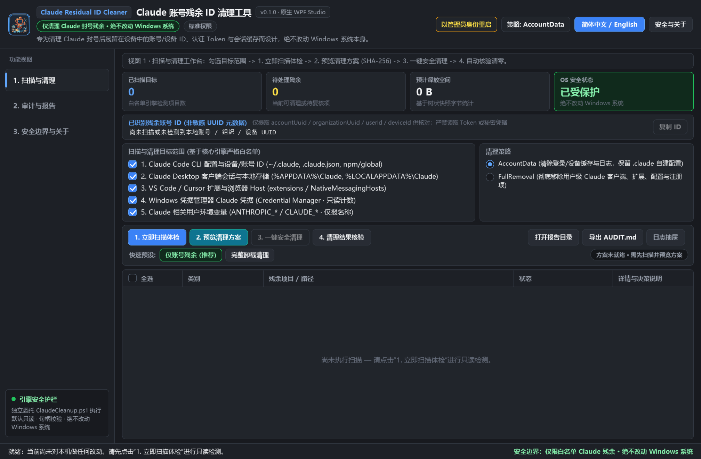

简体中文 | [English](Skills-Usage-Guide.en.md)

# Claude Residual ID Cleaner — 跨代理 Agent Skill 实战指南

**所属项目：** `YUCZ-43/Claude-Residual-ID-Cleaner`（`Claude 账号残余 ID 清理工具`）  
**规范技能包：** [skills/claude-cleanup/SKILL.md](../skills/claude-cleanup/SKILL.md)  
**相关文档：** [中文主 README](../README.md) | [English README](../README.en.md) | [CLI 命令参考](./CLI-Reference.md) | [Skill 安全规范](./Agent-Skill-Guide.md)

本指南面向希望在 **Antigravity（`agy` CLI 与 Desktop）**、**Codex CLI**、**Claude Code** 和 **Gemini CLI** 中安全部署并调用 `claude-cleanup` 技能的 Windows 用户，提供安装、激活、复制即用的提示词及生命周期维护说明。

> 如更偏好图形界面，可直接运行随附的 `Claude-Residual-ID-Cleaner.exe`（与本技能共用同一只读优先后端 [ClaudeCleanup.ps1](../ClaudeCleanup.ps1)）：
>
> 

---

## 1. 安全底线速览

- **单一后端引擎**：[skills/claude-cleanup/](../skills/claude-cleanup/SKILL.md) 不含任何删除脚本，所有操作严格委托仓库根目录的 `ClaudeCleanup.ps1` 执行（`powershell.exe -NoProfile -File ...` 或 `pwsh.exe -NoProfile -File ...`），严禁代理改用 `Remove-Item`、`rd`、`reg delete`、`Remove-AppxPackage` 或 `npm uninstall` 绕过 Win32 句柄校验。
- **100% 只读默认入口**：默认仅执行 `-Audit`（未传 `-SaveAuditReport` 时零写盘）或 `-Verify`；严禁改动 `C:\Windows`、`Program Files`、系统硬件/设备 ID（`MachineGuid`）、WSL 或无关软件；对凭据管理器仅统计匹配计数，对环境变量仅输出 `Scope` 与 `Name`。本地清理不会改变远端账号状态。
- **64 位 SHA-256 哈希门禁**：任何真实 `-Apply` 前必须由用户主动触发 `-Plan` 生成 `CLEANUP-PLAN.md`（`SchemaVersion = 3`），核对 `-WhatIf` 列表与策略（`AccountData` / `FullRemoval`），并确认唯一的 64 位 SHA-256 哈希；台账 `VERIFICATION.md` 保证每份哈希仅能生效一次。
- **严禁策略绕过**：严禁推荐 `-ExecutionPolicy Bypass` / `Unrestricted`、自动 UAC 提权或修改 ACL/所有权。REA 仅为可选开发期静态分析工具，运行时完全不需要。

> 完整权限边界与 Win32 机制见 [permissions-and-risks.md](../skills/claude-cleanup/references/permissions-and-risks.md) 与 [Agent-Skill-Guide.md](./Agent-Skill-Guide.md)。

---

## 2. 安装与四端发现路径

```text
skills/claude-cleanup/
├── SKILL.md
└── references/
    ├── permissions-and-risks.md
    └── agent-installation.md
```

### 2.1 发现路径总览

| AI 代理生态 | `-SkillTarget` 参数 | 项目级路径（相对工作区） | 用户级路径（全局发现目录） |
| :--- | :--- | :--- | :--- |
| **Antigravity（`agy` CLI / Desktop）** | `Antigravity` | `.agents\skills\claude-cleanup\` | `%USERPROFILE%\.gemini\config\skills\claude-cleanup\` |
| **Codex CLI** | `Codex` / `Agents` | `.agents\skills\claude-cleanup\` | `%USERPROFILE%\.codex\skills\claude-cleanup\` 或 `%USERPROFILE%\.agents\skills\claude-cleanup\` |
| **Claude Code** | `Claude` | `.claude\skills\claude-cleanup\` | `%USERPROFILE%\.claude\skills\claude-cleanup\` |
| **Gemini CLI** | `Gemini` | `.gemini\skills\claude-cleanup\` | `%USERPROFILE%\.gemini\skills\claude-cleanup\` |

> 安装/卸载 Skill 仅管理上述 Markdown 文件与 `.claude-cleanup-skill-install.json`，**不会**修改工具本体或 Claude 软件。请勿将 `ClaudeCleanup.ps1` 复制进 `.codex`、`.agents`、`.gemini` 或 `.claude` 目录。

### 2.2 自动化脚本安装（推荐）

在 `Claude-Residual-ID-Cleaner` 仓库根目录运行 [Install-ClaudeCleanup.ps1](../scripts/Install-ClaudeCleanup.ps1)：

```powershell
# 同时安装工具本体（至 %LOCALAPPDATA%\Programs\Claude-Residual-ID-Cleaner）与 Skill
powershell.exe -NoProfile -File .\scripts\Install-ClaudeCleanup.ps1 -InstallSkill -SkillTarget Antigravity

# 仅安装 Skill（-SkillOnly），支持 Codex / Antigravity / Claude / Gemini / Agents / All
powershell.exe -NoProfile -File .\scripts\Install-ClaudeCleanup.ps1 -SkillOnly -SkillTarget All

# 干跑预览
powershell.exe -NoProfile -File .\scripts\Install-ClaudeCleanup.ps1 -SkillOnly -SkillTarget All -Language zh-CN -WhatIf
```

### 2.3 免全局使用与手动安装

- **项目级直接使用**：直接在 `Claude-Residual-ID-Cleaner` 仓库目录内启动代理，或将 `skills\claude-cleanup\` 复制到目标项目下的 `.agents\skills\claude-cleanup\`、`.claude\skills\claude-cleanup\` 或 `.gemini\skills\claude-cleanup\`。
- **手动复制到用户级目录**：

```powershell
# 按需替换目标路径：
# Antigravity: '.gemini\config\skills\claude-cleanup'
# Codex CLI:   '.codex\skills\claude-cleanup'
# Claude Code: '.claude\skills\claude-cleanup'
# Gemini CLI:  '.gemini\skills\claude-cleanup'
$target = Join-Path $HOME '.gemini\config\skills\claude-cleanup'
New-Item -ItemType Directory -Path (Split-Path -Parent $target) -Force | Out-Null
Copy-Item -LiteralPath '.\skills\claude-cleanup' -Destination $target -Recurse -Force
```

### 2.4 各生态触发要点

- **Antigravity**：使用 `/skills` 确认已发现 `claude-cleanup`；当对话涉及本机 Claude 残余扫描时会自动语义触发。若不在工具仓库内工作，请在提示词中附上本地 `ClaudeCleanup.ps1` 路径（如 `C:\Users\<USERNAME>\Tools\Claude-Residual-ID-Cleaner\ClaudeCleanup.ps1`）。
- **Codex CLI**：可用 `$claude-cleanup` 显式调用，例如：`$claude-cleanup 请只读审计当前设备的 Claude 残余项。`
- **Claude Code**：若计划执行 `FullRemoval`（会涉及 `~/.claude` 本身），请先退出所有 `claude` 与 `Code` 进程，改在独立 PowerShell 终端或桌面端执行最终清理。
- **Gemini CLI**：在会话中点名 `claude-cleanup` 技能并附上 `ClaudeCleanup.ps1` 路径与 `-OutputFormat Json`。

### 2.5 安装后静态自检

```powershell
powershell.exe -NoProfile -File .\tests\SkillPackage.Tests.ps1
pwsh.exe -NoProfile -File .\tests\SkillPackage.Tests.ps1
```

---

## 3. 复制即用提示词手册（Prompt Playbook）

在仓库外调用代理时，请将 `.\ClaudeCleanup.ps1` 替换为实际路径（如 `C:\Users\<USERNAME>\Tools\Claude-Residual-ID-Cleaner\ClaudeCleanup.ps1`）。

### Prompt 1：只读残余审计（`-Audit -OutputFormat Json`）

```text
请使用 claude-cleanup 技能，调用本地 ClaudeCleanup.ps1 执行严格只读审计（如当前目录不是工具仓库，请先让我确认或使用 C:\Users\<USERNAME>\Tools\Claude-Residual-ID-Cleaner\ClaudeCleanup.ps1）。
要求：
1. 仅执行：.\ClaudeCleanup.ps1 -Audit -OutputFormat Json -Language zh-CN
2. 不要运行 -Plan，不要运行 -Apply，严禁使用 -ExecutionPolicy Bypass。
3. 按 AccountData 与 FullRemoval 分类汇总识别到的残余文件、非敏感账号 UUID、占用进程、Decision（Ready / ReviewOnly / Blocked）、凭据计数、环境变量名（严禁打印值）与 WSL 只读状态。
```

### Prompt 2：生成确定性清理方案并对比策略（`-Plan`）

```text
我已审阅只读审计结果。请使用 claude-cleanup 技能运行：
.\ClaudeCleanup.ps1 -Plan -OutputFormat Json -Language zh-CN
要求：
1. 生成 CLEANUP-PLAN.md 后立即停止，不要执行 -Apply。
2. 汇报文件路径、PlanId、完整 64 位 SHA-256 哈希，以及 Ready / ReviewOnly / Blocked 数量。
3. 表格对比 AccountData（保留 .claude 自建技能与 claude_desktop_config.json）与 FullRemoval 的清理与保留差异。
```

### Prompt 3：非破坏性干跑预览（`-Apply -WhatIf`）

```text
请使用 claude-cleanup 技能，针对清单哈希 <64-HEX-SHA256>，以 AccountData（或 FullRemoval）执行非破坏性干跑预览：
.\ClaudeCleanup.ps1 -Apply -Policy AccountData -ApprovedManifestSha256 <64-HEX-SHA256> -WhatIf -Language zh-CN
要求：
1. 逐项列出将被删除的 Ready 条目与将被跳过的 ReviewOnly / Blocked 条目。
2. 明确说明当前未删除任何内容，且 -WhatIf 未消耗该 SHA-256 单次授权。
3. 等待我明确回复确认后再继续。
```

### Prompt 4：显式授权清理与独立核验（`-Apply` -> `-Verify`）

```text
我已关闭相关 Claude / VS Code 进程，明确授权以下本地清理（已知晓不可撤销且不改动 Windows OS 或远端账号状态）：
- 策略：AccountData（或 FullRemoval）
- 批准的清单 SHA-256：<64-HEX-SHA256>
请使用 claude-cleanup 技能：
1. 调用 .\ClaudeCleanup.ps1 -Apply -Policy <AccountData|FullRemoval> -ApprovedManifestSha256 <64-HEX-SHA256> -OutputFormat Json -Language zh-CN 执行清理。
2. 结束后立即运行 .\ClaudeCleanup.ps1 -Verify -OutputFormat Json -Language zh-CN。
3. 如实汇报 VERIFICATION.md 台账与各项三态结果（Present / Absent / Unknown），严禁将 Unknown 汇报为 Absent。
```

---

## 4. 升级、纯技能卸载与排查速查

```powershell
# 仅更新 Skill
powershell.exe -NoProfile -File .\scripts\Update-ClaudeCleanup.ps1 -SkillOnly -SkillTarget All

# 仅卸载 Skill（不删除工具本体、其他技能或 Claude 应用）
powershell.exe -NoProfile -File .\scripts\Uninstall-ClaudeCleanup.ps1 -SkillOnly -SkillTarget All
```

手动安装的技能可仅删除各代理目录下的 `claude-cleanup` 子文件夹（`.agents\skills\claude-cleanup`、`.codex\skills\claude-cleanup`、`.gemini\config\skills\claude-cleanup`、`.gemini\skills\claude-cleanup`、`.claude\skills\claude-cleanup`）。

| 常见问题 | 处理方式 |
| :--- | :--- |
| **执行策略阻止运行脚本** | 审阅 `ClaudeCleanup.ps1` 后执行 `Unblock-File -LiteralPath .\ClaudeCleanup.ps1` 或将当前用户策略设为 `RemoteSigned`。**切勿使用 `-ExecutionPolicy Bypass`。** |
| **仓库外找不到 `ClaudeCleanup.ps1`** | 在提示词中给出安装路径 `%LOCALAPPDATA%\Programs\Claude-Residual-ID-Cleaner\ClaudeCleanup.ps1` 或本地仓库路径。切勿把脚本复制进 `.codex` / `.agents` / `.gemini` / `.claude`。 |
| **SHA-256 校验失败或已消费** | 重新运行 `.\ClaudeCleanup.ps1 -Plan` 生成新清单并确认最新的 64 位 SHA-256。 |
| **条目持续为 `Blocked` / `ReviewOnly`** | 多为重解析点（`ReparseBlocked`）、`BUILTIN\Administrators` 属主或人工复核项，详见 [Troubleshooting-and-Compatibility.md](./Troubleshooting-and-Compatibility.md)。 |

---

## 5. 延伸阅读

- [项目主页 (README.md)](../README.md) / [English Home (README.en.md)](../README.en.md)
- [规范技能定义 (SKILL.md)](../skills/claude-cleanup/SKILL.md) · [多代理安装细节](../skills/claude-cleanup/references/agent-installation.md) · [权限与风险边界](../skills/claude-cleanup/references/permissions-and-risks.md)
- [CLI 完整参数参考](./CLI-Reference.md) · [启动器与安装指南](./Launcher-and-Install.md) · [卸载指南](./Uninstallation-Guide.md)
